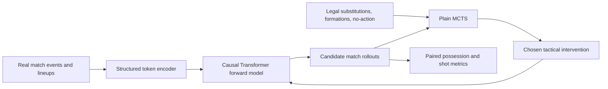

# Football Forward Models for Tactical Decision-Making

This repository accompanies a research project on a practical question in football analytics: **can a generative model of match events be used as a counterfactual simulator for tactical decisions?**

Most event models predict the next action or estimate a static quantity such as expected goals. Here, a real first half becomes the initial state of a simulated second half. A planning algorithm can inject a substitution or formation change, roll the match forward, and compare it with alternative decisions. A generated match is not presented as “the future”; it is a controlled decision laboratory in which coaching actions are evaluated under the same learned dynamics.

## Research approach

The project has three connected layers.

### 1. A structured Football Forward Model

StatsBomb events and lineups are encoded as structured tokens for event type, team, location, time, possession state, and tactical actions. A causal Transformer learns to continue the sequence autoregressively. Given the first half of a held-out match, it generates a plausible second-half event stream.

The forward model is evaluated before planning. Early experiments test architecture, token augmentation, spatial resolution, and repeat stability. This separation matters because a planner can exploit simulator errors; tactical gains are meaningful only when the simulator’s strengths and limitations remain visible.

### 2. Tactical actions as counterfactual interventions

At a decision point, the simulator may receive:

- no action;
- a substitution expressed through the incoming player’s role;
- a tactical formation change.

After the action token is injected, generation continues from the same match history. A paired no-action rollout supplies the counterfactual baseline, reducing noise caused by differences between real and simulated matches.

### 3. Plain Monte Carlo Tree Search

At each eligible minute, the root-level MCTS planner:

1. enumerates legal actions;
2. assigns uniform priors for plain MCTS;
3. allocates a fixed simulation budget using PUCT;
4. generates a continuation for the selected candidate;
5. scores the continuation under the tactical objective;
6. applies the most visited action and advances the simulated match.

This is deliberately an auditable immediate-action search rather than a deep game tree. Decision frequency, number of simulations, and rollout length are varied separately so their effects are not conflated.

## Evaluation philosophy

Every core comparison is paired within the same match and seed:

```text
same real first half
        ├── no-action simulated second half
        └── MCTS-controlled simulated second half
                    ↓
          paired outcome difference
```

Possession gain is reported in percentage points. We also retain the share of matches improved, conditional gain, dispersion, and a bootstrap lower confidence bound. Fixed holdout manifests, deterministic seed formulas, and incremental result files make runs resumable and auditable.

The later experiments ask progressively more applied questions:

- How often should the coach reconsider?
- How much search is useful per decision?
- How far should candidate rollouts look ahead?
- Does behavior adapt when possession is difficult or favorable?
- Can objective weights steer decisions toward shots or ball control?
- Does a recovery period after an active intervention improve the policy?

## System overview



See [Architecture](docs/ARCHITECTURE.md) for the model, search, objective, and cooldown flows.

## Repository guide

```text
.
├── src/impactful_possession_pipeline/  # encoding, model, decoding and planning
├── experiments/                        # launchers, analyses and saved run data
│   └── runs/                           # immutable per-match result artifacts
├── data/holdouts/                      # fixed match-ID manifests
├── docs/                               # concepts, experiments, data and reruns
└── scripts/                            # quick result validation
```

- [Experiment catalog](docs/EXPERIMENTS.md) explains the question, design, and reason for every experiment.
- [Reproduction guide](docs/REPRODUCE.md) separates artifact checks, a one-match smoke test, and full GPU reruns.
- [Data guide](docs/DATA.md) documents provenance, splits, included artifacts, and exclusions.

## Reproducing the work

```bash
python -m venv .venv
source .venv/bin/activate
pip install -r requirements.txt
export PYTHONPATH="$PWD/src"
python -m py_compile src/impactful_possession_pipeline/*.py experiments/*.py
python scripts/summarize_results.py
```

Full commands, expected paths, resume behavior, and validation levels are in [Reproduce](docs/REPRODUCE.md).

## Results at a glance

The strongest adapted plain-MCTS setting used one-minute decisions, five simulations, and 200 rollout tokens. On 50 held-out matches it produced a paired mean possession gain of **+2.34 percentage points**, with **64%** improved and a **+1.08 pp** 90% bootstrap lower confidence bound. This is a compact orientation only; the experiment document contains the full comparisons and caveats.

## Scope and limitations

This is a simulator-based policy study, not evidence that an intervention would cause the same outcome in a real match. Generated shots are under-calibrated, intervention effects depend on learned event dynamics, and the adapted experiments use a modest 50-match sample. Negative and non-monotonic results are preserved rather than hidden.

## Reproducibility status

E01–E09 and Figure 8 are saved with per-match records. The additional cooldown study compares 1-, 5-, and 10-minute recovery thresholds using the same best plain-MCTS configuration; partial conditions remain resumable until their summaries report `complete: true`.
