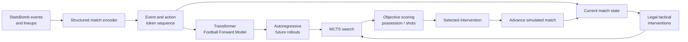
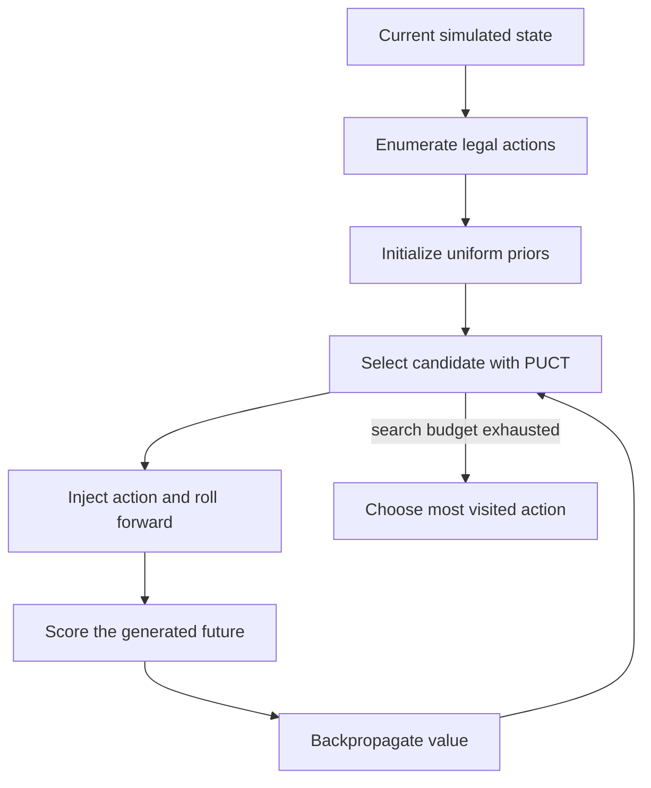

# Football Forward Model for Tactical Planning

An event-based framework for **simulating football matches and planning
in-game tactical interventions** with a learned Football Forward Model (FFM)
and Monte Carlo Tree Search (MCTS).

Most football prediction systems estimate an outcome from a fixed snapshot.
This project instead studies a sequential coaching question:

> Given everything that has happened so far, which legal tactical action should
> be taken now, and how might the remainder of the match develop afterward?

The approach treats a match as a structured event sequence. A transformer
learns the dynamics of that sequence, while MCTS uses the learned model as a
simulator to compare possible interventions. The result is a model-based
decision-support pipeline that can recommend an action, advance the simulated
match, and reconsider the plan as the game state changes.

This repository contains the implementation, fixed evaluation manifests,
experiment launchers, chart-generation code, and machine-readable artifacts
used in the paper reproduction.

## Research idea

The paper connects **football event modelling** with **online tactical
planning**. Its central hypothesis is that a forward model trained to generate
future match events can serve as an environment for evaluating coaching
decisions before they are applied.

The system has two complementary components:

1. **Football Forward Model.** A structured autoregressive transformer learns
   the next-event distribution from StatsBomb event and lineup data. The model
   represents event type, team, player, time, and spatial information as a
   token sequence and can roll a partial match forward.
2. **Tactical planner.** At eligible decision times, MCTS enumerates legal
   interventions, generates model-based futures for each candidate, scores
   those futures under a configurable objective, and selects the most promising
   action.

Unlike a one-shot prediction model, the planner operates in a closed loop:
after an intervention is selected, the simulated match advances and the next
decision is conditioned on the updated state.

## System architecture



### 1. Structured match representation

Raw event and lineup records are transformed into a chronological,
model-readable sequence. The representation preserves the context needed for
simulation and planning: match time, acting team, player identity, event type,
pitch location, and injected tactical actions.

### 2. Learned forward simulation

The FFM predicts future event tokens autoregressively. Starting from the real
first-half and early second-half context, it can generate alternative
continuations of the same match. These continuations are not claimed to be
causal counterfactuals; they are model-based scenarios used for controlled,
paired policy evaluation.

### 3. Search over tactical actions

At each decision point, the planner constructs the legal action set, including
tactical changes and a no-action option. Plain MCTS assigns uniform priors and
uses repeated model rollouts to allocate search toward promising actions.



### 4. Configurable coaching objectives

Rollouts are scored using interpretable football objectives. The experiments
focus on home-team possession and also examine a shots-only objective and a
balanced shots/possession objective. Objective weights can therefore steer the
same planning mechanism toward different tactical preferences.

### 5. Receding-horizon intervention policy

The selected action is inserted into the sequence, the match advances, and
planning repeats from the new simulated state. A recovery-window extension can
temporarily block another active intervention while continuing to evaluate the
state every minute. This tests whether allowing a tactical change time to take
effect produces a more coherent policy.

## What the experiments test

The evaluation is organized as a sequence of controlled questions:

- **Forward-model quality:** architecture, token augmentation, spatial
  resolution, and repeat stability.
- **Planning policy:** random and Markov baselines versus plain and
  model-prior-guided MCTS.
- **Decision frequency:** interventions every 1, 5, or 10 minutes.
- **Search budget:** the number of MCTS simulations allocated to each decision.
- **Lookahead horizon:** the number of generated tokens used to evaluate a
  candidate intervention.
- **Match context:** how gains and intervention choices change when the home
  team has low, balanced, or high possession.
- **Objective trade-offs:** how shots-focused and balanced objectives alter the
  resulting policy.
- **Action recovery:** whether active interventions should be separated by a
  1-, 5-, or 10-minute cooldown.

All policy comparisons use fixed match IDs, deterministic per-match seeds, and
paired no-action rollouts. Variables are swept sequentially so that each
experiment changes one primary design choice while holding the selected
configuration from earlier stages fixed.

## Repository structure

```text
.
├── src/impactful_possession_pipeline/
│   ├── model and structured decoding
│   ├── intervention/action vocabulary
│   ├── MCTS and baseline planners
│   └── evaluation and analysis pipelines
├── experiments/
│   ├── experiment launchers
│   ├── experiment_registry.json
│   └── runs/                       # configurations and result artifacts
├── charts/
│   ├── one reproducible directory per experiment
│   └── standalone paper figures
├── data/holdouts/                  # fixed match-ID manifests
├── docs/
│   ├── ARCHITECTURE.md
│   ├── EXPERIMENTS.md
│   ├── REPRODUCE.md
│   ├── DATA.md
│   └── RESULTS_AUDIT.md
└── scripts/                        # fast validation utilities
```

## Reproducing the work

Create an environment and validate the committed code and artifacts:

```bash
python3 -m venv .venv
source .venv/bin/activate
pip install -r requirements.txt
export PYTHONPATH="$PWD/src"

python3 -m py_compile src/impactful_possession_pipeline/*.py experiments/*.py
python3 scripts/summarize_results.py
```

Model execution additionally requires a trained checkpoint and local copies of
StatsBomb Open Data:

```bash
export FFM_CHECKPOINT=/path/to/best_forward_simulator.pt
export STATSBOMB_EVENTS=/path/to/statsbomb/open-data/data/events
export STATSBOMB_LINEUPS=/path/to/statsbomb/open-data/data/lineups
```

The [reproduction guide](docs/REPRODUCE.md) provides a one-match GPU smoke test,
the full selected configuration, resume instructions, and memory-safety
guidance. Raw StatsBomb data and large model checkpoints are intentionally not
redistributed; their provenance and expected layout are documented in
[DATA.md](docs/DATA.md).

## Results at a glance

The repository emphasizes method and reproducibility; complete values and
interpretation are reported in the [experiment catalog](docs/EXPERIMENTS.md)
and checked in the [results audit](docs/RESULTS_AUDIT.md).

In brief, the controlled sweeps selected plain MCTS with one-minute state
checks, five simulations per eligible decision, and 200-token candidate
rollouts. A subsequent recovery-window study found the strongest tested
aggregate when another active action was blocked for five minutes. These
results are paired effects inside the learned simulator—not causal estimates
of real coaching interventions.

## Reproducibility and reporting principles

- Every saved run records its configuration, per-match rows, aggregates, and
  completion status.
- Policy and no-action futures are paired on the same held-out matches.
- Experiments support incremental persistence and safe resume.
- Reported possession gains are percentage-point differences.
- Historical artifacts, controlled reruns, smoke tests, and incomplete runs are
  labeled separately.
- The controlled E05 rerun is reported as observed: it favors plain MCTS and
  does not reproduce the earlier priors-guided ranking.
- Figures are generated directly from committed result artifacts using the
  scripts under `charts/`.

## Documentation

- [Architecture and planning flow](docs/ARCHITECTURE.md)
- [Experiment questions and configurations](docs/EXPERIMENTS.md)
- [Fast and full reproduction](docs/REPRODUCE.md)
- [Data provenance and artifact policy](docs/DATA.md)
- [Numerical and figure audit](docs/RESULTS_AUDIT.md)
- [Chart catalog and build instructions](charts/README.md)

## Scope

This project is a research prototype for model-based tactical analysis. The
generated futures depend on the learned simulator and available event data.
Recommendations should therefore be interpreted as hypotheses produced under
the model, not as guaranteed real-world outcomes or causal treatment effects.
