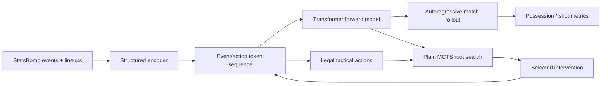
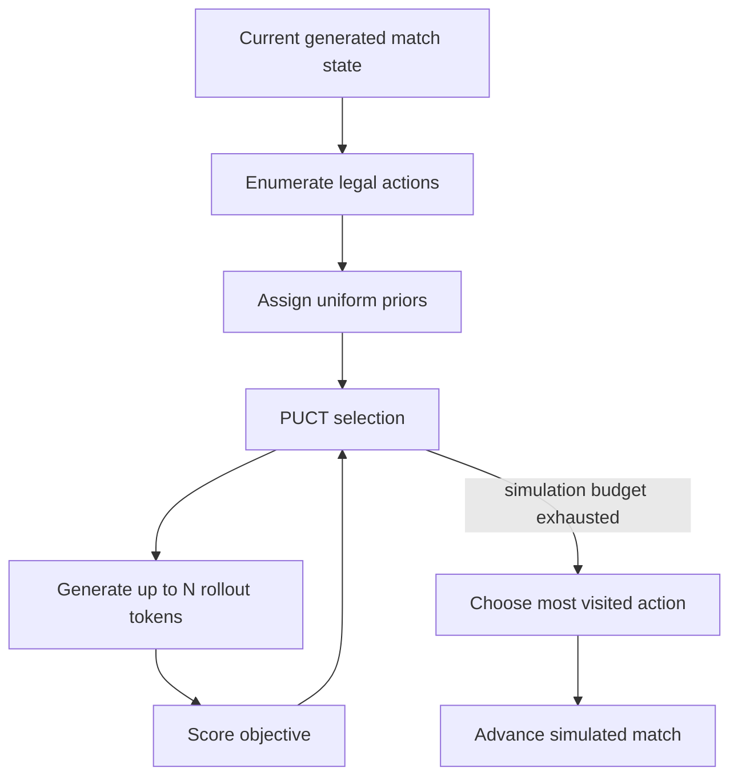
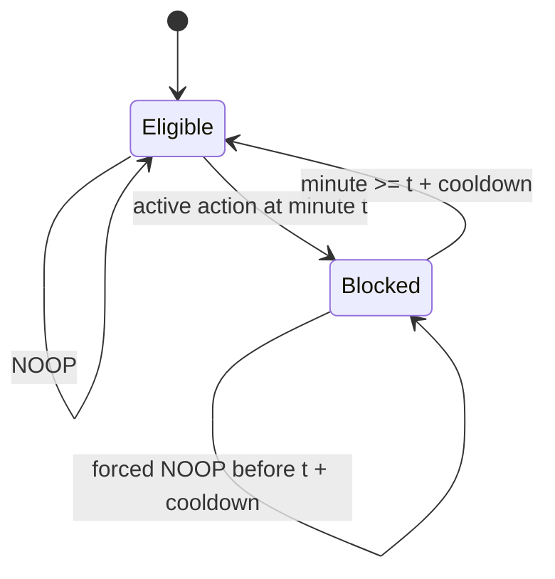

# Architecture

## System flow

The encoder converts real events into structured frames and tokens. At every
eligible decision minute, root-level MCTS allocates a fixed simulation budget
across legal substitutions, tactical formation changes, and no-action. Each
simulation is a free-running model rollout; the chosen action is injected and
the match advances before the next decision.

## Plain-MCTS decision

Plain MCTS uses `uniform_prior_weight=1.0`. Priors-guided runs are retained for
comparison, but the final adapted experiments use uniform priors because they
were more reliable with the available checkpoint.

## Cooldown extension

Decision time remains one minute. Cooldown affects only eligibility for another
active action; blocked minutes are still generated and logged.
