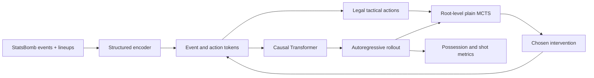
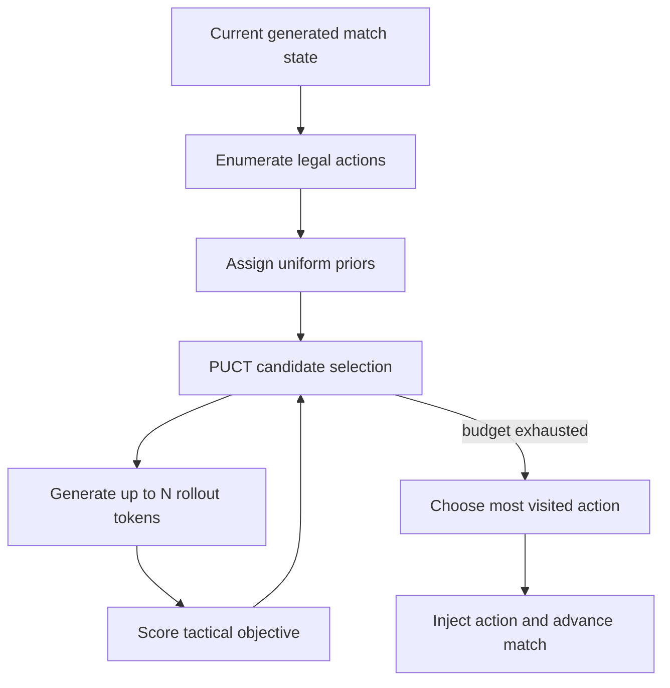
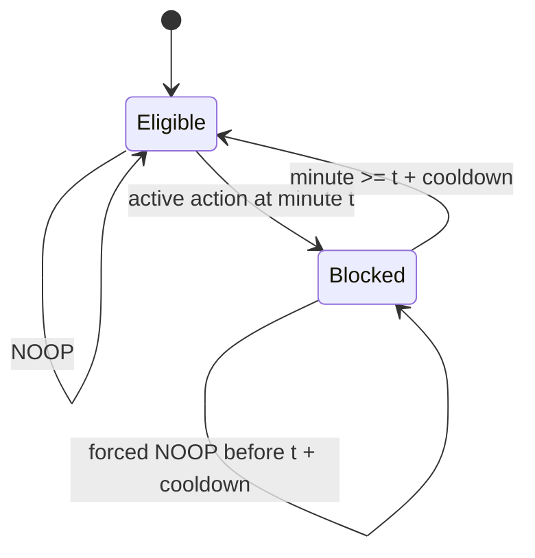

# Architecture and design choices

The system keeps simulation and search separate. The Transformer proposes future match events; MCTS never changes model weights and only chooses which legal action token conditions those futures. Objectives can therefore change without retraining the forward model.

## End-to-end flow

### Why structured tokens?

A language-model-style stream is convenient for generation, but football decisions need explicit state. Tokens preserve event type, acting team, time, pitch zone, possession transition, formation, and injected action. The decoder reconstructs event frames, so evaluation metrics come from interpretable football events rather than hidden states.

### Why a forward model?

A supervised action policy imitates historical coaches and cannot directly answer counterfactual questions. The forward model estimates what event sequence might follow each action. Candidate actions can then be compared inside one learned environment.

## Plain-MCTS decision

Plain MCTS uses `uniform_prior_weight=1.0`. Priors-guided experiments are retained for comparison, but the adapted studies use uniform priors because they were more dependable with the available checkpoint.

### Why root-level search?

The simulator is stochastic and the action set is modest. Repeatedly sampling each immediate candidate yields an auditable estimate without pretending a deeply branched long-term tree is reliable. After applying one action, the newly generated state becomes the root of the next decision.

### Objectives

Possession is the home share of possession-bearing generated events. The optional shot component is the home share of generated shots, keeping both search terms on a 0–1 scale. Evaluation also reports raw shot counts for interpretation.

## Active-intervention cooldown

The decision clock remains one minute. Cooldown only changes eligibility after an active action; blocked minutes are still generated and logged.

This differs from E06. A five-minute E06 policy does not search between decision times. A five-minute cooldown policy monitors and advances every minute but temporarily suppresses further active interventions.

## Reproducibility boundaries

The checkpoint, holdout manifest, decoder parameters, seed formula, legal-action constraints, and objective weights define an experimental condition. Changing any of them creates a new condition and should not be merged into an existing result file.
